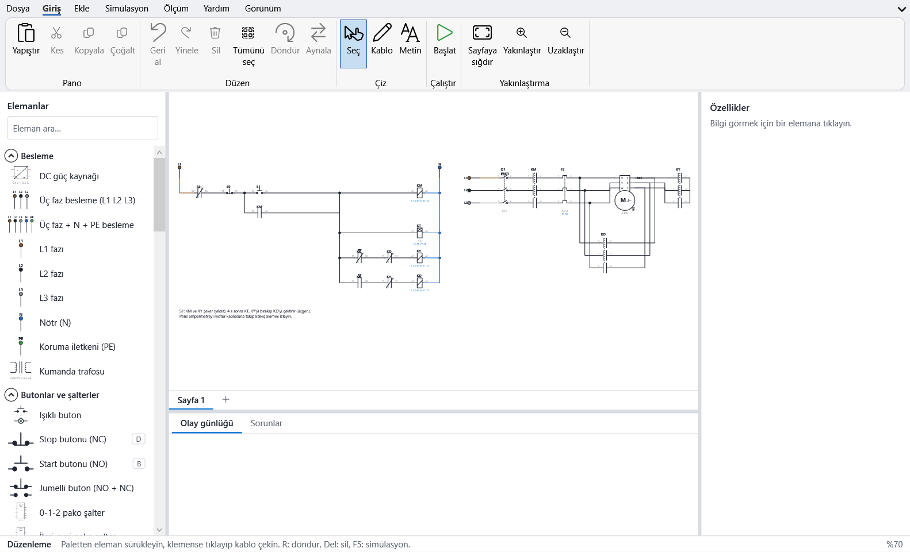
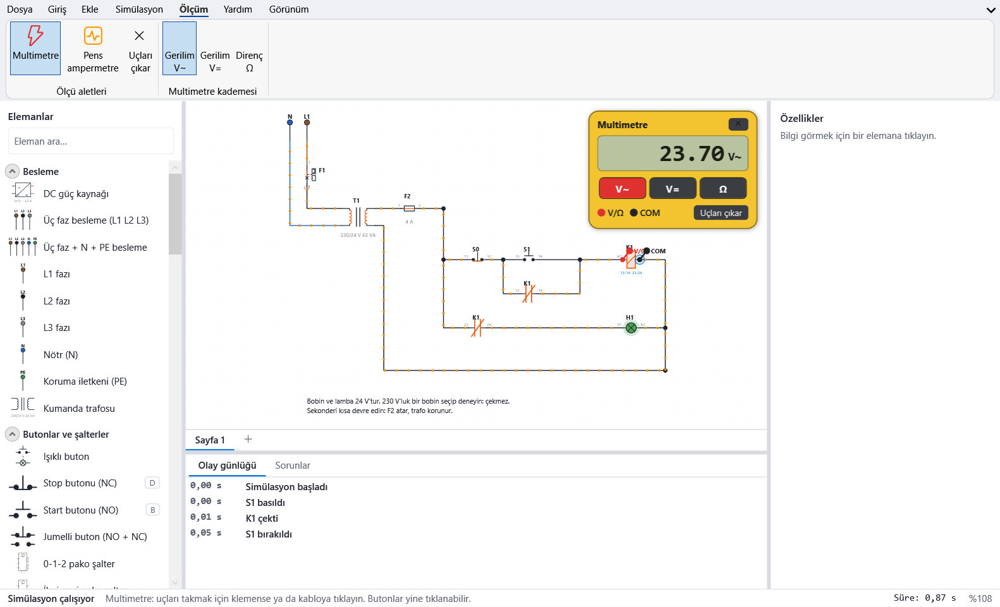
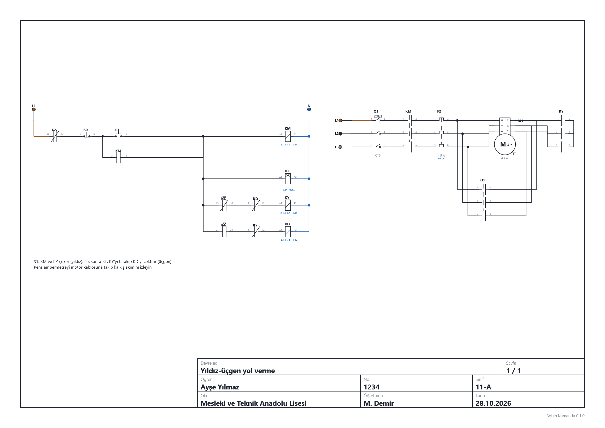
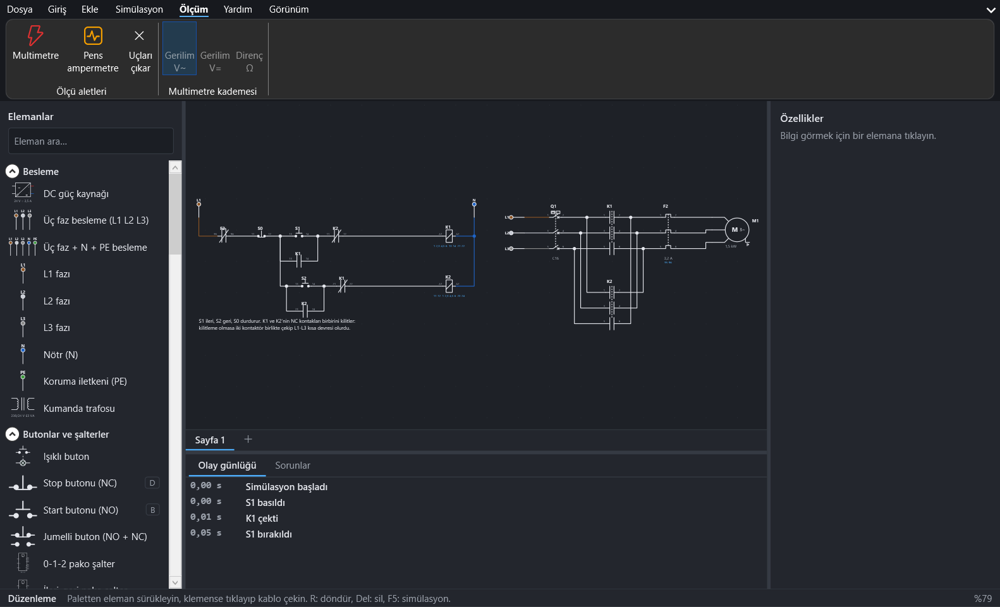

<p align="center">
  
</p>

<p align="center">
  <b>Elektrik kumanda devrelerini çizin, çalıştırın, ölçün.</b><br>
  Meslek liseleri ve üniversiteler için özgür bir kumanda simülatörü · <a href="#english">English</a>
</p>

<p align="center">
  <a href="LICENSE"></a>
  
  
  <a href="https://github.com/alperenyardim30-hash/BobinKumanda/actions"></a>
</p>

---

Bobin Kumanda, kontaktörlü kumanda devrelerini kâğıttaki gibi çizip gerçekte nasıl çalışacaklarını görmenizi sağlar. Butona basarsınız, bobin çeker, motor döner, akım kablolarda akar. Yanlış bir bağlantı yaparsanız program ne olduğunu ve nasıl düzeltileceğini anlatır.

Program, Vepa HALLIYEV'in EKTS'sinden (Marmara Üniversitesi, 2005) esinlenerek **sıfırdan** yazılmıştır. Eski EKTS `.esc` dosyalarını açar ve o biçimde kaydedebilir.



## Özellikler

- **Gerçek devre çözümü.** Her noktadaki gerilim ve her kablodaki akım fazörlerle (MNA) hesaplanır. Kısa devre, yanlış bobin gerilimi, faz eksikliği, kilitlemesi unutulmuş ileri-geri devresi kendiliğinden ortaya çıkar.
- **71 eleman.** Kontaktör ve zaman röleleri, butonlar, acil stop, pako şalterler, W otomatı, sigorta, kaçak akım rölesi, termik röle, motor koruma şalteri, şamandıra, termostat, basınç şalteri, fotosel, endüktif/kapasitif sensör (PNP/NPN), korna, ısıtıcı, selenoid valf, sayıcı, flaşör, yıldız-üçgen rölesi, faz koruma rölesi, üç/bir fazlı, yıldız-üçgen, Dahlander, iki devirli, frenli ve DC motorlar, kumanda trafosu, 24 V DC güç kaynağı. [Tam liste](docs/tr/elemanlar.md)
- **Ölçü aletleri.** Multimetre (V~, V=, Ω) ve kalkış akımını yakalayan pens ampermetre.
- **Arızalar ve koruma.** Motor gövde kaçağı, aşırı yük, kısa devre; koruma elemanları gerçek açma eğrileriyle atar. Sorunlar panelinde neden ve çözüm yazar.
- **Rahat çizim.** Paletten sürükle-bırak, dik açılı otomatik kablolar, ek noktaları, geri al (200 adım), kopyala-yapıştır, çoklu sayfa, IEC'ye göre otomatik etiket ve kontak numarası, çapraz referans.
- **14 hazır örnek devre.** Mühürleme, termik korumalı yol verme, ileri-geri, yıldız-üçgen, sıralı çalışma, şamandıralı pompa, kaçak akım rölesi, 24 V kumanda ve daha fazlası.
- **Çıktı.** Öğrenci bilgili antetle PNG/JPG ve yazdırma (A4/A3).
- **Okul bilgisayarları için.** Zayıf bilgisayarda akıcı çalışır, internet gerektirmez. Türkçe ve İngilizce, açık ve koyu tema.

| Simülasyon ve pens ampermetre | Multimetre |
|---|---|
|  |  |

| Antetli çıktı | Koyu tema |
|---|---|
|  |  |

## Belgeler

- [Kullanım kılavuzu](docs/tr/kullanim-kilavuzu.md)
- [Eleman listesi](docs/tr/elemanlar.md)
- [Dosya biçimleri (.bobin ve .esc)](docs/dosya-bicimi.md)
- [Geliştirici rehberi](docs/gelistirici.md)
- [Wiki](https://github.com/alperenyardim30-hash/BobinKumanda/wiki): kurulum, hızlı başlangıç, sık sorulan sorular

Programın içindeki yardım sayfası (<kbd>F1</kbd>) da aynı bilgileri, eleman sembolleriyle birlikte gösterir.

## Kurulum

Hazır kurulum dosyası (setup.exe) hazırlanıyor. O zamana kadar kaynaktan derleyebilirsiniz:

1. [.NET 10 SDK](https://dotnet.microsoft.com/download) kurun.
2. Depoyu indirin ve derleyin:

```powershell
git clone https://github.com/alperenyardim30-hash/BobinKumanda.git
cd BobinKumanda
dotnet run --project src/BobinKumanda.App -c Release
```

Tek dosyalık, .NET kurulumu gerektirmeyen bir sürüm için:

```powershell
dotnet publish src/BobinKumanda.App -c Release -r win-x64 --self-contained -p:PublishSingleFile=true -p:EnableCompressionInSingleFile=true -p:IncludeNativeLibrariesForSelfExtract=true -o dist
```

Testler: `dotnet test --project tests/BobinKumanda.Core.Tests -c Release`

## Teşekkür

EKTS'yi (Elektrik Kumanda Teknikleri Simülatörü) geliştiren **Vepa HALLIYEV**'e ve tez danışmanı **Yrd. Doç. Dr. Hasan ERDAL**'a (Marmara Üniversitesi, 2005) teşekkür ederiz. Bobin Kumanda, EKTS'nin kodundan değil, programın davranışından ve dosya biçiminden yola çıkarak yeniden yazılmıştır.

## Lisans

[GPL-3.0](LICENSE) © 2026 Bobin Kardeşler. Özgürce kullanabilir, değiştirebilir ve dağıtabilirsiniz; değiştirilmiş sürümler de aynı lisansla paylaşılmalıdır.

---

<a name="english"></a>
## English

Bobin Kumanda lets you draw contactor control circuits as you would on paper and watch how they really behave: press a button, the coil pulls in, the motor turns and current flows through the wires. If something is wired wrongly, it explains what happened and how to fix it.

It was written **from scratch**, inspired by Vepa HALLIYEV's EKTS (Marmara University, 2005), and it can open and save old EKTS `.esc` files.

- **Real circuit solution:** every voltage and wire current is computed with phasors (modified nodal analysis); short circuits, wrong coil voltages, missing phases and missing interlocks show up by themselves.
- **71 components:** contactors, timers, push buttons, cam switches, circuit breakers, fuses, RCDs, overload relays, sensors (float, thermostat, pressure, photocell, PNP/NPN proximity), loads, counters, flashers, star-delta and phase-monitoring relays, three/single-phase, star-delta, Dahlander, two-speed, brake and DC motors, control transformer, 24 V DC supply. [Full list](docs/en/components.md)
- **Instruments:** multimeter (V~, V=, Ω) and a clamp meter that catches the starting current.
- **Faults and protection:** body leakage, overload, short circuit; protective devices trip on realistic curves.
- **Editing:** drag and drop, automatic right-angle wiring, undo, copy/paste, multiple sheets, IEC labels, contact numbering, cross reference.
- **14 sample circuits**, PNG/JPG export and printing with a title block, Turkish and English, light and dark theme, runs well on older school PCs.

Documentation: [user guide](docs/en/user-guide.md) · [components](docs/en/components.md) · [file formats](docs/dosya-bicimi.md) · [wiki](https://github.com/alperenyardim30-hash/BobinKumanda/wiki)

Licence: [GPL-3.0](LICENSE) © 2026 Bobin Kardeşler.
