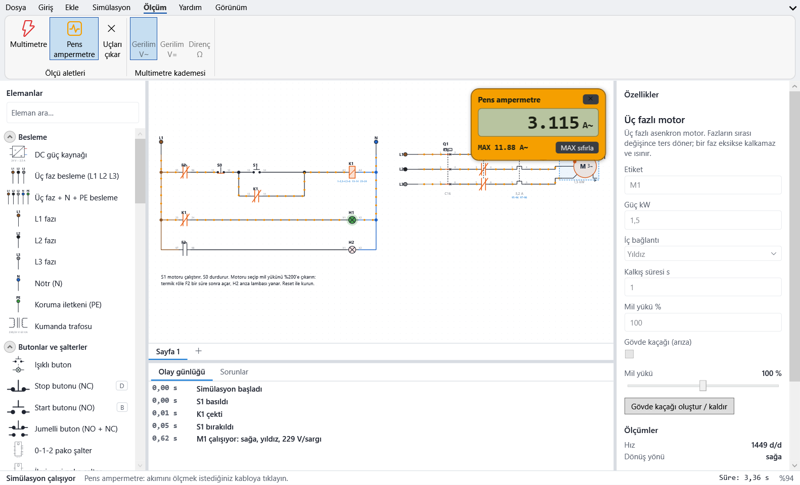

# Belgeler / Documentation

Bobin Kumanda, elektrik kumanda devrelerini çizip gerçek bir devre gibi çalıştıran özgür (GPL-3.0) bir eğitim programıdır.

**İndir / Download:** [son sürüm (Windows 10/11, 64 bit)](https://github.com/alperenyardim30-hash/BobinKumanda/releases/latest)

## Türkçe

- [Kullanım kılavuzu](tr/kullanim-kilavuzu.md)
- [Eleman listesi](tr/elemanlar.md) — katalogdan otomatik üretilir
- [Dosya biçimleri: .bobin ve .esc](dosya-bicimi.md)
- [Geliştirici rehberi](gelistirici.md)

## English

- [User guide](en/user-guide.md)
- [Component list](en/components.md) — generated from the catalogue
- [File formats](dosya-bicimi.md) (Turkish)

Kurulum, hızlı başlangıç ve sık sorulan sorular için [wiki](https://github.com/alperenyardim30-hash/BobinKumanda/wiki)'ye bakın. Kaynak kodu: [GitHub](https://github.com/alperenyardim30-hash/BobinKumanda).
